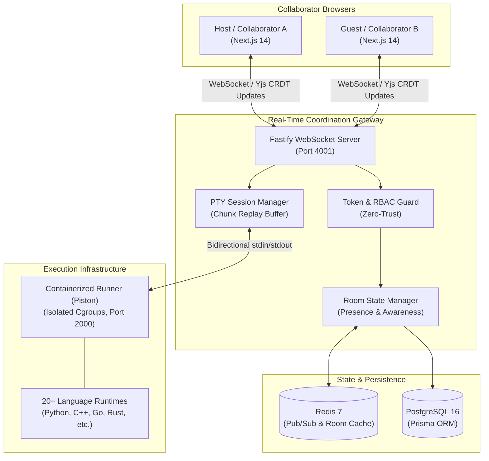

<div align="center">

# Pairly

### High-Performance Real-Time Collaborative Web IDE & Multi-Language Execution Engine

[](https://www.typescriptlang.org/)
[](https://nextjs.org/)
[](https://www.fastify.io/)
[](https://yjs.dev/)
[](https://www.docker.com/)
[](https://turbo.build/)
[](https://vitest.dev/)
[](LICENSE)

<p align="center">
  <b>Pairly</b> is a cloud-native, browser-based collaborative development platform designed for instant pair programming, technical interviews, and real-time distributed code execution.
</p>

[Key Features](#key-features) • [Architecture](#system-architecture) • [Monorepo Layout](#monorepo-structure) • [Getting Started](#getting-started) • [Security & Sandboxing](#security--isolation) • [Testing](#testing--verification)

---

</div>

## Key Features

- **⚡ Conflict-Free Real-Time Collaboration**: Powered by **Yjs CRDTs** over high-throughput WebSockets. Supports multi-file concurrent editing with deterministic convergence and sub-50ms peer synchronization without central document locking.
- **🛡️ Sandboxed Remote Code Execution**: Secure execution across **20+ languages** (Python, C++, TypeScript, Go, Rust, Java, and more) in isolated, resource-capped container runtimes.
- **📟 Interactive Streaming Terminal (PTY)**: Bidirectional `stdin`/`stdout` streaming with chunk buffering and historical replay for late-joining collaborators.
- **🔒 Zero-Trust RBAC & Session Security**: Role-based access control (`OWNER`, `EDITOR`, `VIEWER`) enforced server-side. Ephemeral room tokens and authenticated WebSockets prevent unauthorized writes.
- **💾 Resilient Persistence Architecture**: Hybrid storage model leveraging **Redis** for sub-millisecond pub/sub and ephemeral snapshotting, backed by **PostgreSQL 16** via Prisma for durable workspace retention.
- **🧩 Strict End-to-End Type Safety**: Shared contract package (`@pairly/contracts`) with runtime **Zod** schema validation across all WebSocket events, REST APIs, and database models.

---

## System Architecture



---

## Monorepo Structure

Managed via **Turborepo** and **pnpm workspaces**:

```text
pairly/
├── apps/
│   ├── web/               # Next.js 14 App Router frontend (Monaco Editor, Yjs bindings, UI)
│   └── realtime/          # Fastify WebSocket coordination server & PTY process manager
├── packages/
│   ├── contracts/         # Shared Zod schemas, DTOs, and event specifications
│   ├── database/          # Prisma client, PostgreSQL schema definitions, and migrations
│   ├── execution/         # Multi-language execution client, resource limits, and runners
│   ├── ai/                # AI pair programming context engine and LLM gateway
│   └── config/            # Shared ESLint, Prettier, and TypeScript configurations
├── infra/
│   ├── docker-compose.yml # PostgreSQL 16 & Redis 7 services
│   └── piston/            # Containerized execution runner & runtime package provisioner
└── tests/                 # Full monorepo integration and compliance test suites
```

---

## Security & Isolation

Pairly isolates untrusted code executions using kernel-level container cgroups and strict process limits:

| Security Vector       | Enforcement Policy                                                             |
| :-------------------- | :----------------------------------------------------------------------------- |
| **Execution Timeout** | Hard timeout capped at **10,000 ms** per run                                   |
| **Memory Ceiling**    | Strict memory limit capped at **256 MB**                                       |
| **Process Count**     | Maximum **64** processes to prevent fork bombs                                 |
| **Network Access**    | Outbound networking completely **disabled** (`PISTON_DISABLE_NETWORKING=true`) |
| **Output Bounds**     | Maximum `stdout`/`stderr` output capped at **1 MB** to prevent buffer flood    |
| **File Size Limit**   | File system writes restricted to **10 MB**                                     |

---

## Getting Started

### Prerequisites

Ensure you have the following installed locally:

- **Node.js**: `v20.x` or later
- **pnpm**: `v9.x` (`corepack enable pnpm`)
- **Docker & Docker Compose**: For local PostgreSQL, Redis, and execution sandbox

### 1. Clone & Install Dependencies

```bash
git clone https://github.com/your-username/pairly.git
cd pairly
pnpm install
```

### 2. Environment Setup

Copy the example environment file and configure local credentials:

```bash
cp .env.example .env
```

### 3. Start Infrastructure Services

Spin up PostgreSQL 16 and Redis 7 containers:

```bash
docker compose -f infra/docker-compose.yml up -d
```

_(Optional)_ Start the containerized execution runner and provision language runtimes:

```bash
docker compose -f infra/piston/docker-compose.yml up -d
bash infra/piston/install-packages.sh
```

### 4. Database Setup

Generate the Prisma client and push the database schema:

```bash
pnpm --filter @pairly/database db:push
```

### 5. Launch Development Servers

Start all applications and packages concurrently with live reload:

```bash
pnpm dev
```

- **Web Application**: [`http://localhost:3000`](http://localhost:3000)
- **Realtime WebSocket Server**: [`ws://localhost:4001`](http://localhost:4001)
- **Execution Sandbox API**: [`http://localhost:2000`](http://localhost:2000)

---

## Testing & Verification

Pairly maintains strict automated verification gates across all modules:

```bash
# Run all unit and integration test suites
pnpm test

# Run strict TypeScript typechecking
pnpm typecheck

# Check code style and formatting standards
pnpm lint
```

---

## Supported Languages

The execution engine provides out-of-the-box support for 20+ runtimes:

`Python` • `JavaScript` • `TypeScript` • `C++` • `C` • `Go` • `Rust` • `Java` • `C#` • `Ruby` • `PHP` • `Swift` • `Kotlin` • `Bash` • `SQLite3` • `Lua` • `Zig` • `Haskell` • `Elixir` • `Scala` • `Dart`

---

## License

This project is licensed under the [MIT License](LICENSE) — see the [LICENSE](LICENSE) file for details.
